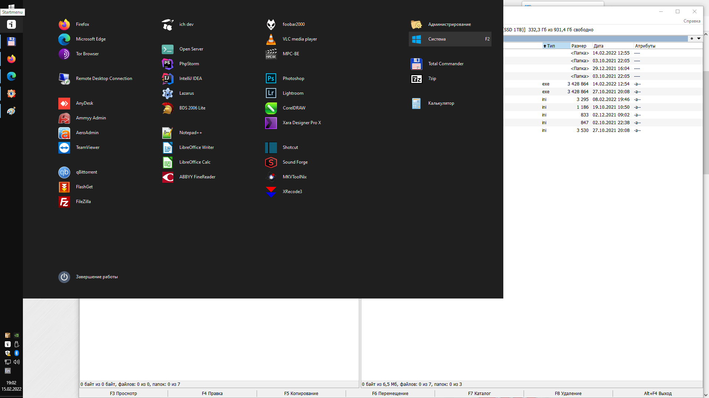
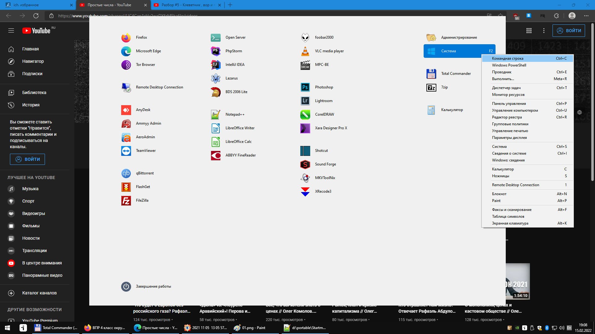
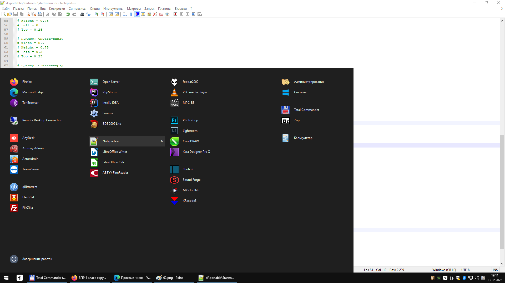
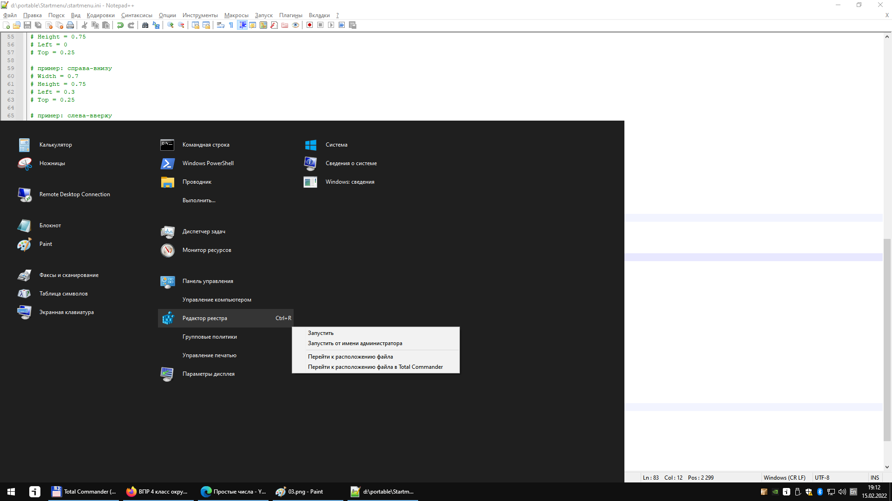
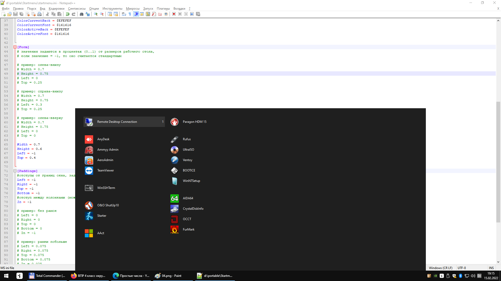
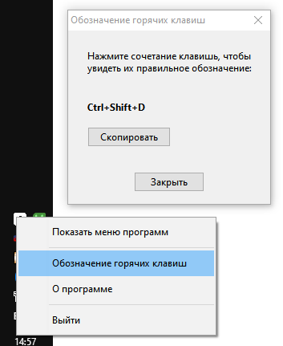

# StartMenu

* **Год написания:** 2021
* **Среда разработки:** Lazarus

После выхода Windows 11 мир был опечален его новым меню кнопки Пуск. Меню доступа к программам и прочим настройкам. Только привыкли к нормальному меню Windows 10, в котором можно было более-менее расставлять и двигать свои иконочки, как вдруг такое…

Поэтому в знак протеста сделал “свое меню”. Идея была такова: поскольку уж так сложилось, что большая часть (да какая большая – почти все) программ, которые я использую в повседневной жизни, у меня в портабельном виде, сделать для них портабельное меню. Которое лежит спокойно прямо в куче этих же программ. Систему переустановил, меню запустил – и уже все работает.

Lazarus, как среда разработки, вылез случайно. Типа посмотреть, что это такое. Посмотрел – не очень. Оно медленнее Delphi, глючнее, синтаксис и нюансы языка отличаются, код так просто из Lazarus в Delphi не перенести. Исполняемый файл получается больше и работает намного медленнее.

Сделано все это на (фу-фу-фу) ini-файлах. Достаточно универсально с обширным функционалом. Пока документации нет (сделано же для себя), но в основных ini-файлах есть поясняющие комментарии. Можно разобраться.

Можно сделать меню любого размера, с любым количеством колонок. Можно менять цвет, расположение и пр. Каждому пункту можно задавать горячую клавишу, приделать всплывающее меню. Можно вызывать самого себя и делать таким образом многоуровневые (вложенные) меню.

После первого запуска программа висит в трее, и дальнейшие вызовы не приводят к повторному запуску, а ускоряют отображение меню. Повторный запуск возможен, если при запуске будет указана другая рабочая директория. Тогда запускается новая копия и файлы конфигурации берутся оттуда. Точнее оттуда, после чтения основного startmenu.ini из папки с исполняемым файлом. Startmenu.ini из рабочей директории обновляет информацию. 

Написание горячих клавиш можно узнать в окне “Обозначение горячих клавиш”, которое вызывается из меню по клику правой кнопки мыши на иконку в трее.

Как это использую я. Закрепляю startmenu на панели задач на самом первом месте. Иконку для ярлыка можно сменить на светлую или темную в свойствах ярлыка в зависимости от темы Windows. Вызов меню происходит по Win+1 (по клику мышки конечно же тоже). Дальше жмакаю мышкой или, чаще, нажимаю горячую клавишу. Стандартное меню по Ctrl+Esc никуда не девается, им пользуюсь также, когда надо. Пользуюсь сам уже несколько лет. 

Программу можно использовать не только как заменитель кнопки Пуск. Например, для оформления каких-нибудь каталогов или наборов игр, или чего-то такого.

Скачать можно в [разделе релизов](./../../releases).

Или на сайте [ich.su](https://ich.su/startmenu). 

Скриншоты:

* 
* 
* 
* 
* 
* 
  
#

страница проекта на гитхабе:
[github.com/ich-su/startmenu](https://github.com/ich-su/startmenu)

страница на ich.su:
[ich.su/startmenu](https://ich.su/startmenu)
